## Create AWS EKS cluster with a Node Group

## Technologies used:

Kubernetes, AWS EKS

## Overview

This project sets up a managed Kubernetes cluster on AWS EKS, from the IAM roles to a running application. A Node Group of EC2 worker nodes is attached to the cluster. The Cluster Autoscaler then adds or removes worker nodes as the workload needs them.

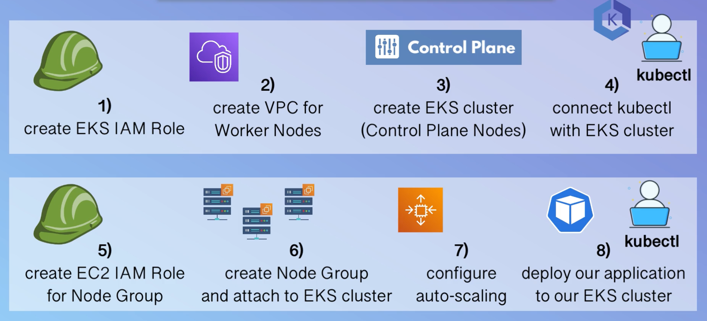<br>
_The eight steps of the project, from the EKS IAM role to deploying the application with kubectl._

<br>

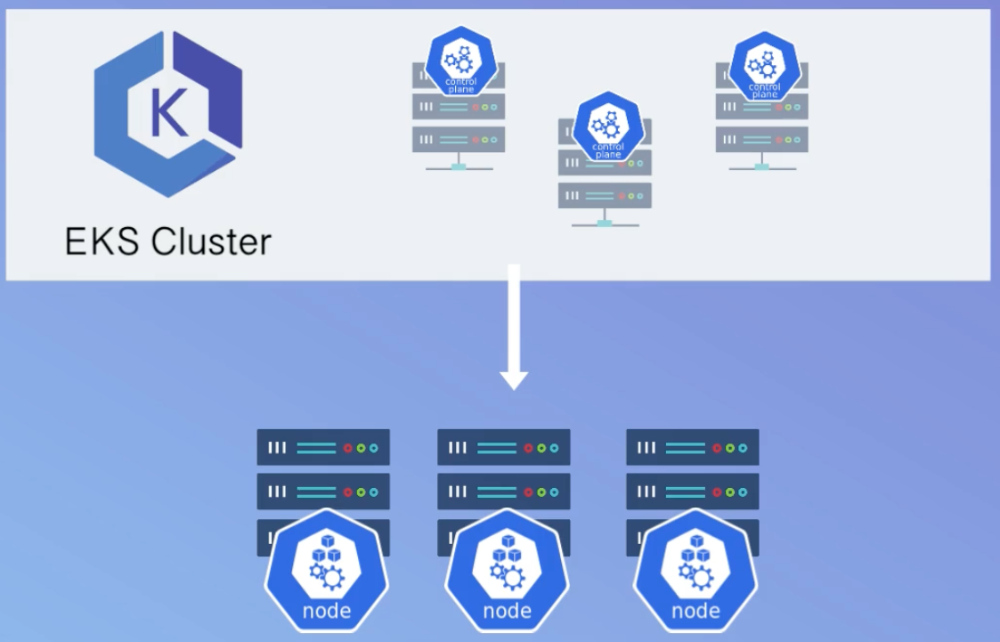<br>
_AWS manages the control plane nodes. The worker nodes in the Node Group run the workloads._

<br>

## 1. IAM roles, VPC and EKS cluster

First I created an IAM role for EKS, so the service can manage AWS resources for the cluster.

The worker nodes need their own network. I created the VPC with public and private subnets using the AWS CloudFormation template for EKS.

Then I created the EKS cluster (the control plane) in that VPC. I connected `kubectl` to it by updating the local kubeconfig with `aws eks update-kubeconfig`.

<br>

## 2. Node Group for the worker nodes

Next I created an EC2 IAM role for the Node Group and attached the standard EKS worker node policies.

I then created a Node Group and attached it to the cluster. The group has a minimum of 1 node, a maximum of 3 nodes, and spans two availability zones.

<br>

## 3. Auto-scaling of worker nodes

The Cluster Autoscaler runs as a pod inside the cluster and changes the desired capacity of the Node Group's Auto Scaling group. It needs AWS permissions to do that. These are defined in [custom-policy.json](custom-policy.json) and attached to the `EKSServiceAccountRole`. The autoscaler's ServiceAccount uses that role.

The autoscaler is deployed from [cluster-autoscaler-autodiscover.yaml](cluster-autoscaler-autodiscover.yaml), which is based on the official template. I updated it with the role annotation, the AWS region, the cluster name for auto-discovery, and an image version that matches the cluster. All changes are listed in [commands.md](commands.md).

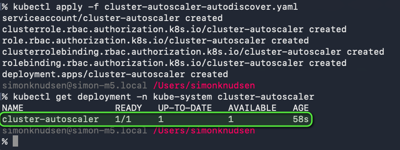<br>
_The autoscaler's ServiceAccount, RBAC resources and Deployment are created, and the Deployment is ready (1/1)._

<br>

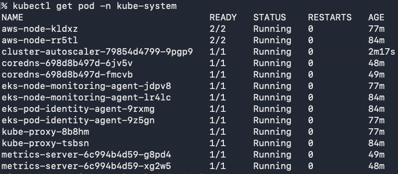<br>
_The cluster-autoscaler pod is running in the kube-system namespace next to the EKS system pods._

<br>

The cluster had two worker nodes, but the workload only needed one. The autoscaler marked the extra node as unschedulable, drained it, and removed it.

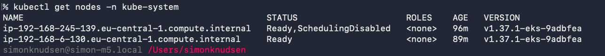<br>
_One of the two nodes is marked SchedulingDisabled while the autoscaler drains it._

<br>

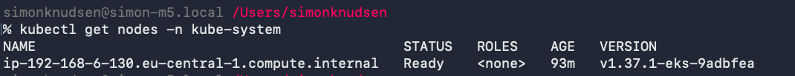<br>
_After the scale-down, one worker node is left._

<br>

<br>
_The Auto Scaling group in the AWS console is at its desired capacity of 1 instance (min 1, max 3)._

<br>

## 4. Deploy a sample application

To test the cluster, I deployed nginx with a Service of type `LoadBalancer` from [nginx.yaml](nginx.yaml). AWS then creates a load balancer in front of the worker nodes.

```
kubectl apply -f nginx.yaml
```

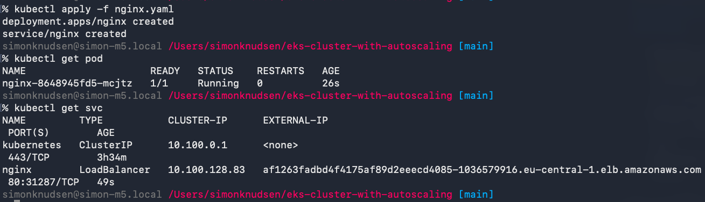<br>
_The nginx pod is running, and the Service has a public AWS load balancer address._

<br>

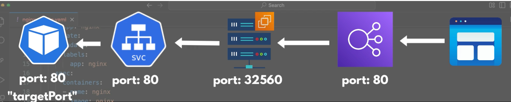<br>
_How a request reaches the pod: browser → load balancer (port 80) → NodePort on a worker node → Service (port 80) → nginx container (targetPort 80)._

<br>

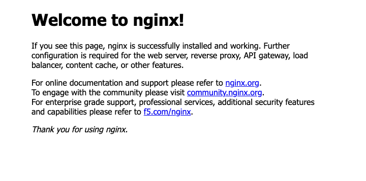<br>
_The nginx welcome page opens in the browser through the load balancer address._

<br>

## 5. Testing auto-scaling with the application

To check that the cluster scales up, I raised the nginx Deployment to 20 replicas with `kubectl edit deployment nginx`. One node did not have room for all the pods, so the autoscaler added worker nodes.

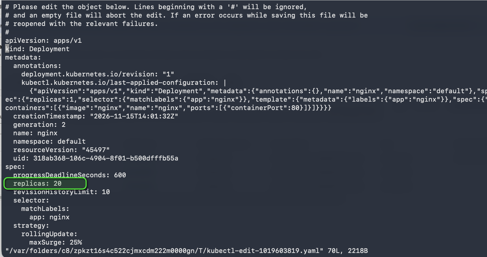<br>
_The nginx Deployment is edited to run 20 replicas._

<br>

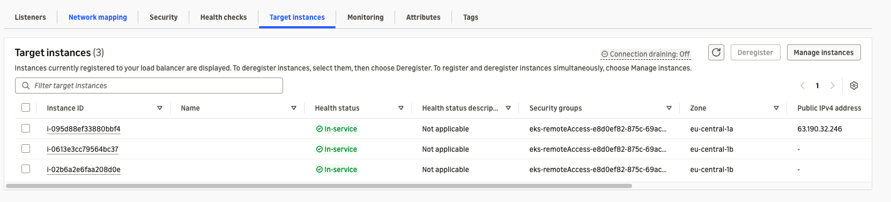<br>
_The load balancer now has 3 healthy target instances, the maximum size of the Node Group._

<br>

Then I set the replicas back to 1. The autoscaler removed the nodes that were no longer needed.

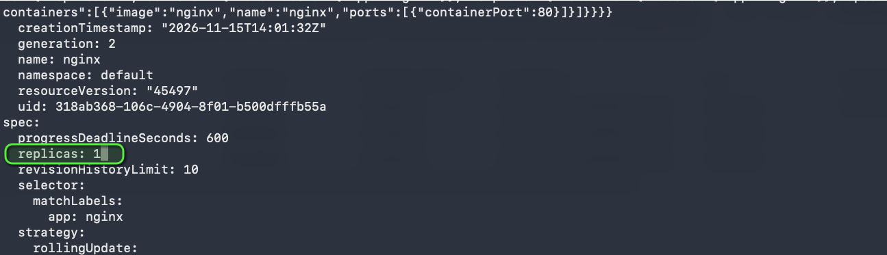<br>
_The nginx Deployment is set back to 1 replica._

<br>

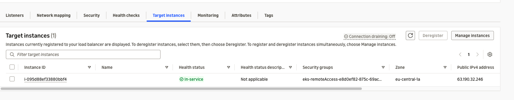<br>
_The load balancer is back to a single target instance after the scale-down._

<br>

# Create EKS cluster with Fargate profile

## Technologies used:

Kubernetes, AWS EKS, AWS Fargate

## Overview

Fargate runs pods without EC2 worker nodes that I have to manage. AWS starts a small, separate compute unit for each pod. A Fargate profile decides which pods run on Fargate. In this project the profile selects pods in the `dev` namespace. All other pods still run on the Node Group.

<br>

## 1. Fargate IAM role and Fargate profile

First I created an IAM role for Fargate with the `AmazonEKSFargatePodExecutionRolePolicy`. EKS uses this role to start pods on Fargate.

Then I created the Fargate profile `dev-profile` on the cluster. It uses the private subnets of the VPC and matches pods in the `dev` namespace.

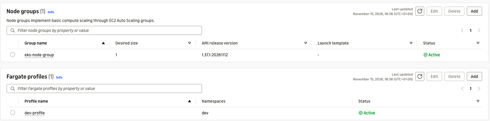<br>
_The cluster now has both compute types: the Node Group `eks-node-group` and the Fargate profile `dev-profile` for the `dev` namespace. Both are Active._

<br>

## 2. Deploy an application with the Fargate profile

I updated [nginx.yaml](nginx.yaml) so the nginx Deployment runs in the `dev` namespace and has the label `profile: fargate`. Then I created the namespace and deployed it.

```
kubectl create namespace dev
kubectl apply -f nginx.yaml
```

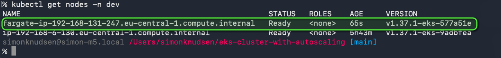<br>
_A new `fargate-ip-...` node appears next to the EC2 worker node. Fargate started it for the nginx pod in the `dev` namespace._

<br>

# Create EKS cluster with eksctl

## Technologies used:

Kubernetes, AWS EKS, Eksctl, Linux

## Overview

In the first project I created the IAM roles, the VPC, the cluster and the Node Group one by one. eksctl does all of this with a single command. It creates the resources through CloudFormation stacks and uses sensible defaults for everything I don't set myself. This saves a lot of manual work.

<br>

## 1. Create the cluster with one command

I set the cluster name, Kubernetes version, region and Node Group settings as options on `eksctl create cluster`. The Node Group uses `t2.micro` instances, starts with 2 nodes and can scale between 1 and 3.

```
eksctl create cluster \
  --name demo-cluster \
  --version 1.37 \
  --region eu-central-1 \
  --nodegroup-name demo-nodes \
  --node-type t2.micro \
  --nodes 2 \
  --nodes-min 1 \
  --nodes-max 3
```

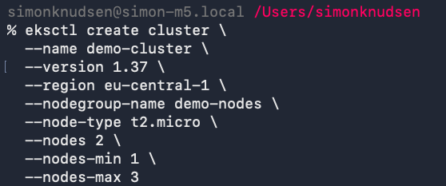<br>
_The `eksctl create cluster` command with the settings for the cluster and its Node Group._

<br>

## 2. eksctl creates the resources

eksctl first creates the control plane and the add-ons such as `vpc-cni` and `kube-proxy`. Then it builds the managed Node Group in its own CloudFormation stack. This takes a while: the Node Group stack alone was still being created after more than 25 minutes.

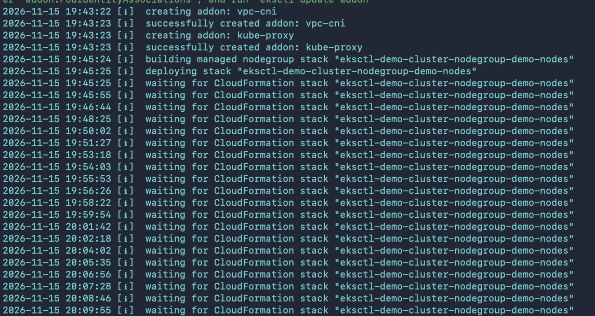<br>
_eksctl creates the `vpc-cni` and `kube-proxy` add-ons, then deploys the CloudFormation stack for the `demo-nodes` Node Group and waits for it to finish._
